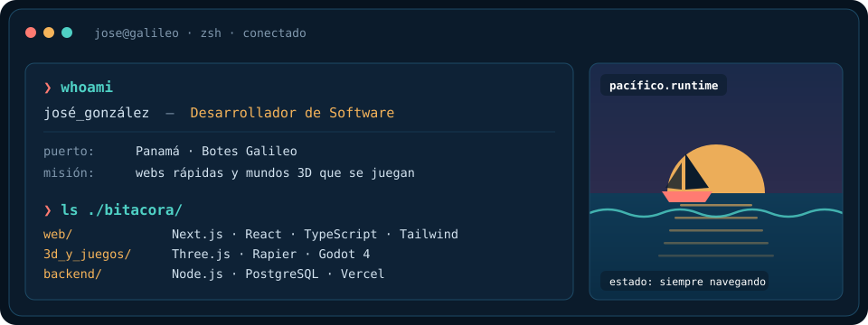
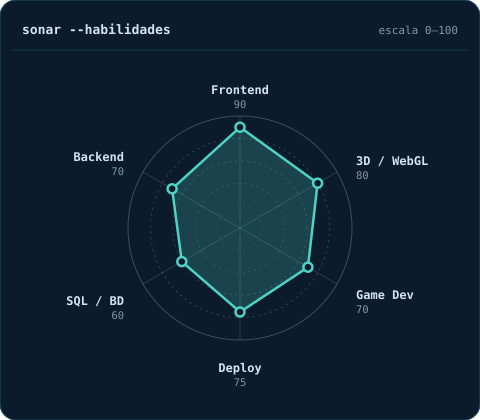
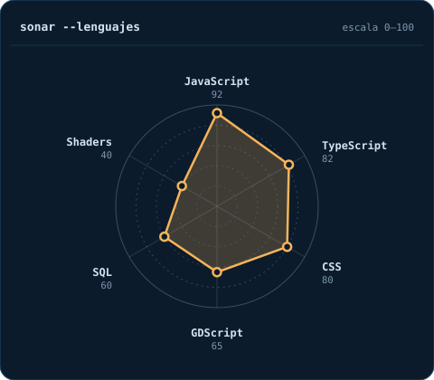

<a href="https://github.com/JoseDev945">
  <picture>
    <source media="(prefers-color-scheme: dark)" srcset="assets/banner-dark.svg">
    <source media="(prefers-color-scheme: light)" srcset="assets/banner-light.svg">
    
  </picture>
</a>

 

---

## `❯ whoami`

  <picture>
    <source media="(prefers-color-scheme: dark)" srcset="assets/whoami-dark.svg">
    <source media="(prefers-color-scheme: light)" srcset="assets/whoami-light.svg">
    
  </picture>

 

## `❯ cat stack.toml`

<table cellpadding="14">
  <thead>
    <tr>
      <th colspan="2" align="left"><code>jose@galileo:~$ cat stack.toml</code></th>
    </tr>
  </thead>
  <tbody>
    <tr>
      <td width="50%" valign="top"><code>⚓ [web]</code>  
         
        <code>Next.js · React · TypeScript · Tailwind CSS</code>
      </td>
      <td width="50%" valign="top"><code>🧭 [tres_d]</code>  
        
         
        <code>Three.js · Rapier (física) · PeerJS · WebGL · Vite</code>
      </td>
    </tr>
    <tr>
      <td valign="top"><code>🎮 [juegos]</code>  
         
        <code>Godot 4 · GDScript · Shaders</code>
      </td>
      <td valign="top"><code>🛠 [backend]</code>  
         
        <code>Node.js · PostgreSQL (Neon) · Serverless Functions</code>
      </td>
    </tr>
    <tr>
      <td valign="top"><code>🚀 [deploy]</code>  
         
        <code>Vercel · Blob · Analytics · Speed Insights</code>
      </td>
      <td valign="top"><code>🔧 [herramientas]</code>  
         
        <code>Git · GitHub · pnpm · JavaScript · HTML · CSS</code>
      </td>
    </tr>
  </tbody>
  <tfoot>
    <tr>
      <td colspan="2"><code>rumbo: producción&nbsp;&nbsp;·&nbsp;&nbsp;puerto: Panamá</code></td>
    </tr>
  </tfoot>
</table>

---

## `❯ ls ~/proyectos`

| Proyecto | Qué es | Stack |
|---|---|---|
| [**GALILEO**](https://github.com/JoseDev945/GALILEO) | Sitio web de Botes Galileo: catálogo de modelos, galería por uso y cotización por WhatsApp | `Next.js` `TypeScript` `Tailwind` `Vercel` |
| [**PORTAFOLIO**](https://github.com/JoseDev945/PORTAFOLIO) | Portafolio 3D: navegas en bote entre islas y cada isla es un proyecto | `Three.js` `Rapier` `PeerJS` `Vite` |
| [**TIENDA**](https://github.com/JoseDev945/TIENDA) | *Regateo*: marketplace entre personas con chat en cada publicación | `Node.js` `PostgreSQL` `Vercel Functions` |
| [**Fruit-Brawl**](https://github.com/JoseDev945/Fruit-Brawl) | Juego de combate con arquitectura por componentes, IA de enemigos y pruebas | `Godot 4` `GDScript` |

---

## `❯ sonar --scan`

  <picture>
    <source media="(prefers-color-scheme: dark)" srcset="assets/sonar-skills-dark.svg">
    <source media="(prefers-color-scheme: light)" srcset="assets/sonar-skills-light.svg">
    
  </picture>&nbsp;
  <picture>
    <source media="(prefers-color-scheme: dark)" srcset="assets/sonar-langs-dark.svg">
    <source media="(prefers-color-scheme: light)" srcset="assets/sonar-langs-light.svg">
    
  </picture>

---

## `❯ ping jose`

&nbsp;&nbsp;

  

Navegando entre código y olas desde Panamá 🇵🇦 · @JoseDev945

